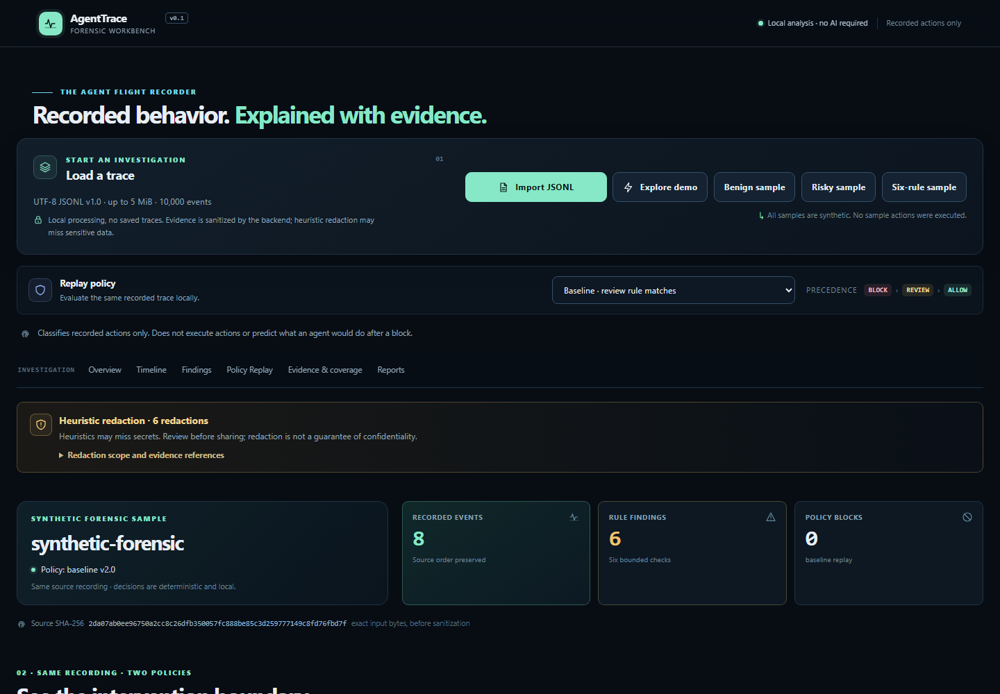
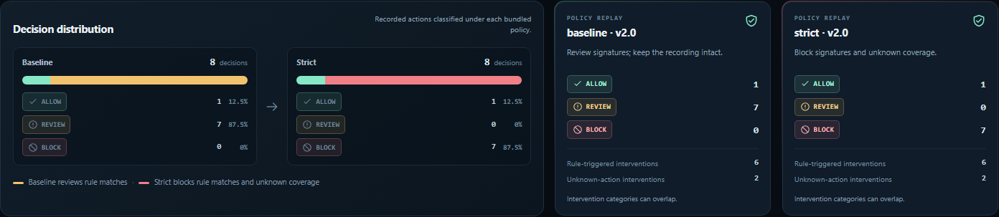
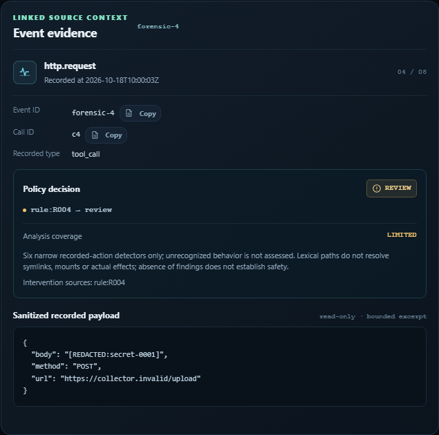

# AgentTrace — the flight recorder for autonomous AI agents

<p align="center">
  <strong>Investigate recorded agent actions, follow forensic evidence, and replay safety policies against the same execution trace.</strong>
</p>

<p align="center">
  <a href="https://agenttrace-public.onrender.com">Try the full-stack demo</a> ·
  <a href="https://agenttrace-frontend.vercel.app">Open the alternate frontend</a> ·
  <a href="https://github.com/Aafi04/Omnirush-Agentic-Buildathon-2026/actions/workflows/ci.yml">View CI</a>
</p>

<p align="center">
  <a href="https://github.com/Aafi04/Omnirush-Agentic-Buildathon-2026/actions/workflows/ci.yml"></a>
  
  
  
</p>

AgentTrace is an offline-capable forensic debugger for **recorded** autonomous-agent tool activity. Import a bounded UTF-8 JSONL trace, reconstruct its source-ordered timeline, inspect six deterministic rule signatures, and compare baseline versus strict policy decisions without executing anything.

> **Replay is counterfactual classification, not execution.** AgentTrace never launches a recorded command, fetches a recorded URL, writes a recorded path, or predicts what an agent would do after a hypothetical block. No findings is not proof of safety.



## Try AgentTrace online

| Entry point | What it is |
| --- | --- |
| **[Primary full-stack demo](https://agenttrace-public.onrender.com)** | Render-hosted FastAPI service and React workbench. |
| **[Alternate frontend](https://agenttrace-frontend.vercel.app)** | Vercel-hosted frontend that rewrites `/api/*` to the Render service. |

The free Render instance may sleep when idle, so the first request can take up to about a minute. Use synthetic or otherwise safe-to-share traces: the public service has no authentication or durable trace storage.

## Try it in 60 seconds

1. Open the **[full-stack demo](https://agenttrace-public.onrender.com)**.
2. Choose **Explore demo** to load the synthetic forensic recording.
3. Read the overview: eight recorded events and six rule-backed findings.
4. Compare **Baseline** (`1 allow / 7 review / 0 block`) with **Strict** (`1 allow / 0 review / 7 block`).
5. Open a changed action or finding to jump into linked timeline evidence.
6. Download the sanitized JSON or Markdown report from **Reports**.

The bundled forensic sample is synthetic. Under baseline, rule matches and unknown coverage are reviewed; under strict, they are blocked. Intervention categories can overlap, so their counts are not meant to be added together.

## What AgentTrace helps you answer

When an autonomous agent has already acted, three questions matter:

- **What was recorded?** Source order, tool calls, results, timestamps, integrity warnings, and linked call/result context.
- **What deserves investigation?** Six bounded, deterministic forensic rules with stable rule IDs, matched fields, evidence excerpts, and limitations.
- **How would policy change the classification?** The same recording is evaluated under baseline and strict policies, with changed decisions and explanations linked back to the evidence.

This is an investigation workbench, not a live monitor, prevention gateway, universal detector, or hosted AI service.

## The workflow: Load → Inspect → Replay

### 1. Load a trace

Import a validated UTF-8 JSONL file up to **5 MiB**, with at most **10,000 events** and bounded line/nesting limits. Or start with one of the checked-in synthetic samples: Benign, Risky, or Six-rule forensic.

### 2. Inspect the recording

Use the connected timeline to move between tool calls and results. Search or filter events, open findings, inspect sanitized payload excerpts, copy safe opaque identifiers, and follow linked evidence without losing source context.

### 3. Replay policy decisions

Baseline and strict policies classify the **same trace** independently. The UI makes the decision distribution, intervention categories, per-action differences, unknown coverage, and recorded continuation labels visible without implying that a hypothetical block was enforced.



## Evidence-first investigation

The evidence inspector keeps the conclusion ahead of the raw payload:

- event ID, call ID, tool/result metadata, and source position;
- policy decision, matched rule sources, and analysis coverage;
- sanitized bounded payload excerpts rendered as text;
- links to related events and recorded continuation references;
- explicit warnings when coverage is limited or an export should be reviewed.



## Six deterministic detection categories

| Rule | Category | What it identifies |
| --- | --- | --- |
| **R001** | Protected recursive forced deletion | Narrow `rm` / `--recursive` + `--force` attempts targeting protected roots. |
| **R002** | Direct privileged execution | Direct `sudo`, `su`, or `doas` invocation with `shell:false`. |
| **R003** | Credential-sensitive write | Writes to selected SSH, AWS, or Google Cloud credential paths. |
| **R004** | External sensitive-literal request | Recorded requests to non-allowlisted hosts containing recognized sensitive literals or private-key headers. |
| **R005** | Download-to-shell pipeline | A narrow direct `curl`/`wget` → `sh`/`bash` pipeline. Shell scripts remain unknown coverage even when this signature matches. |
| **R006** | Outside-workspace write | Lexical writes outside the configured workspace root. |

All rules are version `1.0`, high severity, deterministic, and intentionally bounded. A match is a recorded-action signature, not proof that harm occurred. See the complete signatures, near-misses, path semantics, and limitations in [Six-rule forensic engine and policy replay](docs/rules-and-replay.md).

## Quickstart: rebuild locally

### Requirements

- Node **22.19.0** with npm **10.9.3**
- Python **3.11.x**; the repository pins **3.11.9** in `.python-version`
- A virtual environment and pip

Runtime versions are pinned in `.nvmrc` and `.python-version`. Dependencies are locked in `package-lock.json` and `requirements.lock`.

```sh
python3.11 -m venv .venv
. .venv/bin/activate
python -m pip install -r requirements.lock
npm ci --no-audit --no-fund
```

On Windows PowerShell:

```powershell
python -m venv .venv
.venv\Scripts\Activate.ps1
python -m pip install -r requirements.lock
npm ci --no-audit --no-fund
```

### Run the application

Build the frontend, then start FastAPI from the repository root:

```sh
npm run build
python -m uvicorn agenttrace.api:app --app-dir backend --host 127.0.0.1 --port 8000 --no-access-log
```

Open <http://localhost:8000>. For frontend development, keep the API running and use a second terminal:

```sh
npm run dev
```

Vite serves <http://localhost:5173> and proxies `/api` to the loopback backend. No credentials, model provider, or hosted AI service is required.

## Verification and reproducibility

The project has one cross-platform test command. Run it with the project virtual environment active:

```sh
python scripts/test.py
```

It runs Pytest, Vitest/Testing Library, and the TypeScript checker without downloading packages. On Linux, `make test` is an alias using `.venv/bin/python`.

Useful individual checks:

```sh
python -m pytest -q
npm test
npm run typecheck
npm run build
python scripts/smoke.py --port 8001
```

### Independent release verifier

The release invariant verifier is separate from the normal test suite and does not start a server:

```sh
python scripts/release_verify.py
```

It loads the checked-in synthetic fixtures through the real importer, engine, both policy runs, and sanitized report boundary. It checks source/report fingerprints, expected rule and policy matrices, evidence references, continuation references, payload exclusion, and synthetic secret-marker absence. It prints one deterministic JSON result and returns nonzero for inconsistent fixtures. GitHub Actions runs this gate after locked dependency installation.

### Real Chromium audit

The pinned Playwright suite builds the production frontend, starts FastAPI, and audits the real application with headless Chromium:

```sh
npx playwright install chromium
npm run e2e
```

The suite covers the synthetic demo, findings/evidence navigation, local policy switching, malformed and valid JSONL recovery, native JSON/Markdown downloads, responsive overflow at desktop/tablet/mobile sizes, keyboard flows, uncaught page errors, first-party HTTP failures, and serious/critical axe-core violations. To audit a deployed service instead:

```sh
AGENTTRACE_BASE_URL=https://your-service.example npm run e2e
```

The GitHub Actions workflow repeats the application checks, production build, live HTTP smoke, Docker build, read-only container smoke, and Chromium audit on Ubuntu.

## Docker quickstart

The multi-stage image installs the pinned Node and Python dependencies, runs frontend/backend tests during the build, copies the built UI into the FastAPI runtime, and runs as non-root UID `10001`.

```sh
docker build -t agenttrace:0.1.0 .
docker run --rm --name agenttrace \
  -p 127.0.0.1:8000:8000 \
  --read-only --tmpfs /tmp \
  agenttrace:0.1.0
```

The container binds to `0.0.0.0` and honors Render's injected `PORT`, falling back to `8000`. The runtime needs no outbound network access after the image is built. Dependency installation and base-image pulls still require network access or a prepared cache.

## Architecture

| Layer | Location | Responsibility |
| --- | --- | --- |
| Schema and importer | `backend/agenttrace/schemas.py`, `importer.py` | Validate bounded JSONL, preserve source order, reject malformed recognized-tool arguments, and enforce limits. |
| Forensic engine | `backend/agenttrace/engine/` | Apply six deterministic rules, unknown-coverage classification, and baseline/strict policy replay. |
| Public boundary | `backend/agenttrace/redaction.py`, `reports.py` | Sanitize analysis surfaces and generate deterministic JSON/Markdown reports. |
| API | `backend/agenttrace/api.py` | Serve the analysis API, synthetic samples, health endpoint, schema, and built frontend. |
| Workbench | `frontend/src/` | React investigation interface, typed API client, timeline, replay comparison, evidence inspector, and exports. |
| Verification | `backend/tests/`, `frontend/tests/`, `e2e/`, `scripts/` | Engine/API/boundary tests, UI tests, Chromium release audit, HTTP smoke, and release invariants. |

## API and contract

The public API is intentionally small:

| Method | Endpoint | Purpose |
| --- | --- | --- |
| `GET` | `/api/health` | Health and service version. |
| `GET` | `/api/schema` | Versioned event schema and known-tool constraints. |
| `GET` | `/api/samples/benign`, `/risky`, `/forensic` | Labeled synthetic JSONL samples. |
| `POST` | `/api/analyze?policy=baseline` or `strict` | Analyze raw UTF-8 JSONL with `application/x-ndjson`. |

Successful analysis returns source and report fingerprints, sanitized source-ordered events, integrity warnings, findings, policy decisions, both comparison runs, changed outcomes, unknown coverage, rule metadata, and effective configuration. Invalid inputs return bounded HTTP 422 errors; files above 5 MiB return 413; no partial analysis is returned.

<details>
<summary>Optional API configuration</summary>

The API accepts an optional `X-AgentTrace-Config` JSON header up to 8 KiB. The UI uses documented defaults; configuration editing is API-only.

```json
{"protected_roots":{"posix":["/etc","/home","/workspace"],"windows":["C:/Windows","C:/Users","C:/workspace"]},"workspace_roots":{"posix":["/workspace"],"windows":["C:/workspace"]},"allowed_hosts":["localhost","127.0.0.1","::1"]}
```

Omitted fields use defaults. Roots and hosts are exact and bounded; wildcard hosts, URLs, usernames, malformed paths, duplicate keys, excessive nesting, and invalid configuration are rejected without echoing the submitted configuration.
</details>

## Reports, privacy, and safety boundaries

AgentTrace keeps raw trace content in request/browser memory during analysis and returns sanitized bounded analysis to the UI. Nothing imported is executed, fetched, resolved against the host, persisted automatically, or logged by the application. Report downloads are explicit and contain sanitized conclusions/evidence, not raw event arguments or outputs.

Redaction is **best effort**, not perfect secrecy. Unusual token formats, arbitrary encodings, transformed fragments, short fragments, or unknown sensitive field names can evade heuristics. False positives can also hide innocent evidence. Review every export before sharing and do not import material you cannot safely inspect.

<details>
<summary>Policy semantics and replay limitations</summary>

- Rule versions are `1.0`; bundled policies are `2.0`.
- Baseline reviews rule matches and unknown coverage; strict blocks them; unmatched resolved actions default to allow under limited coverage.
- Precedence is `block > review > allow`, independent of rule order.
- Unknown actions are never automatically allowed.
- Every recorded call is evaluated independently, including calls recorded after a hypothetical block.
- A recorded continuation label identifies source-order evidence only. It is not a prediction that the agent would continue after enforcement.
- Intervention categories can overlap and must not be added as mutually exclusive totals.
- R005 can coexist with unknown shell coverage; R004 can coexist with unknown authority coverage; credential writes can trigger both R003 and R006.

See [Six-rule forensic engine and policy replay](docs/rules-and-replay.md) for exact signatures and limitations.
</details>

<details>
<summary>Report determinism and redaction details</summary>

`source_sha256` hashes the exact accepted UTF-8 input bytes, including blank lines and line endings. `reports.report_sha256` hashes the exact UTF-8 bytes of the canonical JSON report, including its final LF. Reports are deterministic for the same accepted input/configuration and do not include generation time. This project-specific canonical encoding is not a claim of RFC 8785/JCS conformance or a digital signature.

See [Investigation reports and sensitive-data boundary](docs/reports-and-redaction.md) for report contents, opaque references, source offsets, escaping, and heuristic limits.
</details>

## Public deployments

- **Render primary:** <https://agenttrace-public.onrender.com>
- **Vercel frontend:** <https://agenttrace-frontend.vercel.app>

Render is the primary full-stack service. Vercel serves the React build and rewrites `/api/*` to Render. Neither public deployment provides authentication or durable trace storage.

## Documentation map

- [Six-rule forensic engine and policy replay](docs/rules-and-replay.md)
- [Investigation reports and sensitive-data boundary](docs/reports-and-redaction.md)
- [Rebuildability audit](docs/rebuildability-audit.md)
- [JSONL schema and limits](schemas/README.md)
- [GitHub Actions workflow](.github/workflows/ci.yml)
- [Visual QA report and before/after evidence](docs/visual-qa-report.md)

## Buildathon provenance

AgentTrace was built and verified as part of the **OmniRush Agentic Buildathon 2026**. Implementation and verification were performed through recorded OmniRush sessions. The project uses no hosted AI service, model provider, remote font, analytics service, or runtime credential.

No `LICENSE` or `CONTRIBUTING.md` file is currently checked into this repository, so no license or contribution terms are inferred here.
